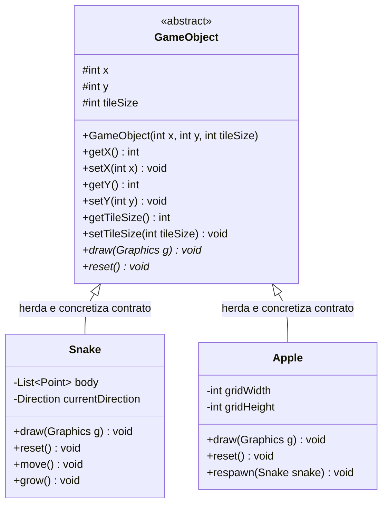

# Pilar da Abstração Aplicado ao Snake Game

Este documento apresenta uma análise aprofundada sobre a aplicação do pilar da **Abstração** no projeto acadêmico **Snake Game (Jogo da Cobrinha)**, desenvolvido em **Java** para a disciplina de Programação Orientada a Objetos (POO).

---

## 1. Fundamentação Teórica da Abstração

### O que é Abstração em POO e Java?
A **Abstração** é o pilar da Orientação a Objetos responsável por **identificar as características essenciais e comportamentos fundamentais de uma entidade do domínio do problema**, ocultando e isolando os detalhes acidentais ou específicos de implementação.

No contexto da linguagem Java:
- A abstração permite definir **modelos conceituais** através de classes abstratas (`abstract class`) e interfaces (`interface`).
- Uma **classe abstrata** funciona como uma "planta conceitual": ela estabelece o que as entidades derivadas devem ser e quais contratos devem cumprir, mas proíbe sua instanciação direta (`new GameObject()` gera um erro de compilação imediato).
- Os **métodos abstratos** (`abstract returnType methodName();`) definem a assinatura e o comportamento obrigatório que toda subclasse concreta deve obrigatoriamente implementar, garantindo uniformidade na arquitetura do sistema.

### Por que a Abstração é necessária?
Sem abstração, os sistemas tendem a se tornar coleções de classes heterogêneas e desconexas, exigindo que o desenvolvedor conheça detalhes íntimos de cada componente para manipulá-los. Com a abstração, o sistema passa a depender de conceitos estáveis e previsíveis, promovendo alto desacoplamento e facilitando a manutenção e a evolução do software.

---

## 2. A Abstração no Contexto do Snake Game

No desenvolvimento do jogo da cobrinha em uma grade 2D (*grid*), surgem elementos distintos em tela:
- A **Cobra** (`Snake`), que se move, cresce, possui corpo articulado em múltiplos nós e colide.
- A **Maçã** (`Apple`), que é fixa a cada instante, sorteia novas coordenadas aleatórias e possui uma representação visual estática de fruta.

Apesar de desempenharem papéis funcionais distintos, ambas compartilham a mesma essência existencial no universo do jogo:
1. **Posicionamento Espacial:** Toda entidade ocupa uma posição no sistema cartesiano da grade discreta (`x`, `y`).
2. **Dimensão Visual:** Toda entidade obedece à mesma escala gráfica e proporção em pixels (`tileSize`).
3. **Capacidade de Renderização:** Toda entidade deve saber como se desenhar no painel gráfico através do contexto do Java AWT (`draw(Graphics g)`).
4. **Ciclo de Vida e Reinicialização:** Toda entidade precisa restaurar seu estado inicial quando uma nova partida for deflagrada (`reset()`).

Para capturar essa essência sem acoplar regras específicas da cobra ou da maçã, foi concebida a classe abstrata [`GameObject`](file:///c:/Users/joaov/Desktop/Backend-2S-ADS/snake-game/src/GameObject.java).



---

## 3. Análise Detalhada dos Trechos de Código em `src/`

### 3.1. A Definição do Contrato Abstrato: `GameObject.java`

O arquivo [`GameObject.java`](file:///c:/Users/joaov/Desktop/Backend-2S-ADS/snake-game/src/GameObject.java) personifica com rigor o conceito de classe abstrata em Java:

```java
// Localização: src/GameObject.java (linhas 13-30 e 58-70)
public abstract class GameObject {
    // Características essenciais compartilhadas por qualquer entidade no grid
    protected int x;
    protected int y;
    protected int tileSize;

    public GameObject(int x, int y, int tileSize) {
        this.x = x;
        this.y = y;
        this.tileSize = tileSize;
    }

    /**
     * Método abstrato obrigatório para desenhar o objeto na tela gráfica.
     * Cada classe filha concreta fornecerá sua própria representação visual.
     */
    public abstract void draw(Graphics g);

    /**
     * Método abstrato para redefinir o estado do objeto ao reiniciar a partida.
     */
    public abstract void reset();
}
```

#### Destaques técnicos da abstração:
1. **Modificador `abstract` na classe:** Impede que o programador cometa o erro de instanciar diretamente um "objeto de jogo genérico". Não faz sentido existir no tabuleiro algo que seja puramente `GameObject` sem ser cobra, fruta ou obstáculo.
2. **Métodos `draw(Graphics g)` e `reset()` sem corpo:** Terminados com ponto e vírgula (`;`), declaram *o que* deve ser feito, mas não *como*. A responsabilidade de definir o algoritmo de renderização e de restauração de estado é delegada integralmente às subclasses concretas.

---

### 3.2. Concretização da Abstração na Maçã: `Apple.java`

A classe [`Apple.java`](file:///c:/Users/joaov/Desktop/Backend-2S-ADS/snake-game/src/Apple.java) estende `GameObject` e cumpre o contrato abstrato implementando a lógica visual de uma maçã (sombra, círculo vermelho, brilho e folha):

```java
// Localização: src/Apple.java (linhas 60-97)
@Override
public void reset() {
    this.x = RANDOM.nextInt(gridWidth);
    this.y = RANDOM.nextInt(gridHeight);
}

@Override
public void draw(Graphics g) {
    Graphics2D g2d = (Graphics2D) g;
    g2d.setRenderingHint(RenderingHints.KEY_ANTIALIASING, RenderingHints.VALUE_ANTIALIAS_ON);

    int px = x * tileSize;
    int py = y * tileSize;
    int padding = 3;
    int size = tileSize - (padding * 2);

    // Renderização dos detalhes cosméticos da maçã
    g2d.setColor(new Color(0, 0, 0, 50));
    g2d.fillOval(px + padding + 1, py + padding + 2, size, size); // Sombra

    g2d.setColor(new Color(231, 76, 60));
    g2d.fillOval(px + padding, py + padding, size, size);         // Corpo vermelho

    g2d.setColor(new Color(255, 255, 255, 140));
    g2d.fillOval(px + padding + (size / 4), py + padding + (size / 5), size / 4, size / 4); // Brilho

    g2d.setColor(new Color(39, 174, 96));
    g2d.fillOval(px + (tileSize / 2) - 1, py + 1, 4, 6);          // Folha
}
```

---

### 3.3. Concretização da Abstração na Cobra: `Snake.java`

A classe [`Snake.java`](file:///c:/Users/joaov/Desktop/Backend-2S-ADS/snake-game/src/Snake.java) cumpre exatamente o mesmo contrato conceitual, porém com um nível de complexidade interna adaptado à sua anatomia composta por múltiplos segmentos móveis:

```java
// Localização: src/Snake.java (linhas 51-63 e 187-214)
@Override
public void reset() {
    body.clear();
    this.x = initialX;
    this.y = initialY;
    this.currentDirection = Direction.RIGHT;
    this.nextDirection = Direction.RIGHT;
    this.growing = false;

    for (int i = 0; i < initialLength; i++) {
        body.add(new Point(initialX - i, initialY));
    }
}

@Override
public void draw(Graphics g) {
    Graphics2D g2d = (Graphics2D) g;
    g2d.setRenderingHint(RenderingHints.KEY_ANTIALIASING, RenderingHints.VALUE_ANTIALIAS_ON);

    int padding = 1;
    int size = tileSize - (padding * 2);

    for (int i = 0; i < body.size(); i++) {
        Point segment = body.get(i);
        int px = segment.x * tileSize + padding;
        int py = segment.y * tileSize + padding;

        if (i == 0) {
            // Desenha a cabeça e os olhos orientados
            g2d.setColor(new Color(46, 204, 113));
            g2d.fillRoundRect(px, py, size, size, 10, 10);
            drawEyes(g2d, px, py, size);
        } else {
            // Desenha o corpo com gradiente sutil
            int colorShift = Math.min(50, i * 2);
            Color bodyColor = new Color(39 + (colorShift / 3), 174 - (colorShift / 2), 96);
            g2d.setColor(bodyColor);
            g2d.fillRoundRect(px + 1, py + 1, size - 2, size - 2, 8, 8);
        }
    }
}
```

---

## 4. Comparação: Código COM Abstração vs. Código SEM Abstração

Para evidenciar o ganho de qualidade e clareza proporcionado pela abstração, compare as duas abordagens abaixo:

### Abordagem SEM Abstração (Código Acoplado e Rígido)
Sem a classe abstrata `GameObject`, o painel principal (`GamePanel`) precisa gerenciar variáveis desconexas e manipular manualmente cada detalhe de renderização e reinício de cada objeto:

```java
// ❌ MODELO SEM ABSTRAÇÃO: O GamePanel precisa conhecer detalhes íntimos de tudo
public class GamePanelSemAbstracao extends JPanel {
    private Snake snake;
    private Apple apple;
    private Obstacle stone; // Se adicionar um obstáculo, mais código solto!

    public void restartGame() {
        // Cada objeto é reiniciado de forma manual e diferente
        snake.reiniciarSegmentosCorpo();
        apple.sortearNovaCoordenadaFruta();
        stone.recarregarPosicaoRocha();
    }

    @Override
    protected void paintComponent(Graphics g) {
        super.paintComponent(g);
        // O GamePanel precisa invocar métodos de nomes arbitrários e gerenciar cada um
        snake.desenharCobraNaTela(g);
        apple.pintarMacaVermelha(g);
        stone.renderizarPedraCinza(g);
    }
}
```
**Problemas gerados:**
- **Falta de padronização:** Cada classe cria seus próprios métodos (`reiniciarSegmentosCorpo`, `sortearNovaCoordenadaFruta`), gerando inconsistência e confusão.
- **Alto acoplamento:** O painel precisa conhecer todas as classes concretas. Ao adicionar um novo item (ex: fruta dourada), é necessário alterar múltiplos métodos em `GamePanel`.

### Abordagem COM Abstração (Projeto Atual do Snake Game)
Com a abstração de `GameObject`, o `GamePanel` interage exclusivamente com a abstração:

```java
// ✅ MODELO COM ABSTRAÇÃO: GamePanel depende apenas do contrato GameObject
public class GamePanel extends JPanel {
    private final List<GameObject> gameObjects = new ArrayList<>();

    public void startNewGame() {
        snake.reset();
        apple.respawn(snake);
        // Ambos respeitam o contrato uniforme
    }

    @Override
    protected void paintComponent(Graphics g) {
        super.paintComponent(g);
        // Itera sobre a abstração sem se preocupar com os detalhes de desenho
        for (GameObject obj : gameObjects) {
            obj.draw(boardG);
        }
    }
}
```
**Vantagens obtidas:**
- **Contrato Uniforme:** O método `draw(Graphics g)` possui a mesma assinatura em todas as entidades.
- **Princípio da Responsabilidade Única:** O `GamePanel` cuida da orquestração do jogo; como cada entidade se desenha é responsabilidade exclusiva de cada classe concreta.

---

## 5. Relação da Abstração com os Demais Pilares

A Abstração atua como alicerce estrutural para os demais pilares no projeto:

1. **Abstração e Herança:** A classe abstrata `GameObject` serve como **superclasse** direta de `Snake` e `Apple`, viabilizando o reuso de campos e métodos de posicionamento (`x`, `y`, `tileSize`).
2. **Abstração e Polimorfismo:** Os métodos abstratos `draw(Graphics g)` e `reset()` definem os pontos de variação polimórfica que o `GamePanel` consome sem conhecer as classes filhas.
3. **Abstração e Encapsulamento:** A classe abstrata expõe atributos protegidos (`protected`) e métodos de acesso públicos (`getX()`, `getY()`), garantindo que apenas entidades do mesmo pacote ou subclasses acessem diretamente os dados brutos.

---

## 6. Guia Rápido para Apresentação Acadêmica

> **Pergunta provável do professor:**  
> *"Por que `GameObject` foi declarada como classe abstrata (`abstract class`) e não como uma classe comum ou interface?"*

**Resposta modelo:**  
`GameObject` é uma classe abstrata porque ela combina **estado comum reutilizável** (os atributos `x`, `y`, `tileSize` com seus respectivos getters e setters) com **comportamentos conceituais obrigatórios sem implementação prévia** (os métodos abstratos `draw` e `reset`).  
Se fosse uma classe concreta, permitiria instanciar `new GameObject()`, o que violaria o modelo conceitual do jogo, pois não existe um "objeto genérico" na tela. Se fosse uma interface pura, não permitiria armazenar diretamente os atributos compartilhados de coordenadas nem os construtores de inicialização da grade. Por isso, a classe abstrata é a solução arquitetural ideal.

