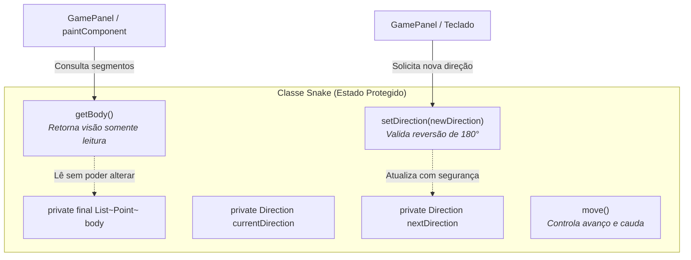

# Pilar do Encapsulamento Aplicado ao Snake Game

Este documento detalha como o pilar do **Encapsulamento** foi rigorosamente aplicado no desenvolvimento do projeto acadêmico **Snake Game (Jogo da Cobrinha)** em Java, demonstrando como a proteção do estado interno garante a integridade das regras do jogo e a robustez da arquitetura orientada a objetos.

---

## 1. Fundamentação Teórica do Encapsulamento

### O que é Encapsulamento em POO e Java?
O **Encapsulamento** é o princípio de **ocultar os detalhes de implementação e o estado interno de um objeto** (*data hiding*), permitindo que seu estado só seja acessado ou modificado de forma estritamente controlada através de métodos públicos e operações de negócio bem definidas.

No ecossistema Java, o encapsulamento é sustentado por três mecanismos centrais:
1. **Modificadores de Acesso:**
   - `private`: O membro é visível única e exclusivamente dentro da própria classe em que foi declarado.
   - `protected`: O membro é visível pelas classes do mesmo pacote e por qualquer subclasse (mesmo em outros pacotes).
   - `public`: O membro é acessível irrestritamente por qualquer classe do sistema.
   - *Padrão (Package-Private)*: Visível apenas por classes pertencentes ao mesmo pacote.
2. **Métodos de Acesso (Getters e Setters com Validação):** Garantem que dados só sejam lidos ou alterados quando atenderem às invariantes de negócio da aplicação.
3. **Imutabilidade e Cópia Defensiva:** Mecanismos como `final` e coleções não-modificáveis (`Collections.unmodifiableList`) para evitar mutações colaterais externas.

### Por que o Encapsulamento é fundamental?
Sem encapsulamento, qualquer classe externa pode manipular diretamente os atributos de um objeto, levando a estados inválidos, violações das regras do jogo e erros imprevisíveis e difíceis de rastrear. Com o encapsulamento, o próprio objeto é o guardião de sua integridade.

---

## 2. O Encapsulamento no Contexto do Snake Game

No Snake Game, a integridade dos dados é crucial para que a partida funcione sem falhas:
- A cobra não pode inverter o movimento em 180° instantaneamente (ex: ir para a direita e, no instante seguinte, para a esquerda), pois isso faria sua cabeça bater no próprio pescoço de forma anti-jogo.
- A lista de segmentos do corpo da cobra (`List<Point> body`) não pode ser adulterada externamente por classes visuais ou utilitárias.
- A maçã não pode surgir em posições fora da grade ou sobreposta a qualquer segmento do corpo da cobra.
- As variáveis de pontuação (`score`, `highScore`) e estado (`currentState`) do painel de jogo não podem ser reescritas arbitrariamente por componentes de entrada do teclado.



---

## 3. Análise Detalhada dos Trechos de Código em `src/`

### 3.1. Proteção de Movimento e Validação de 180°: `Snake.java`

No arquivo [`Snake.java`](file:///c:/Users/joaov/Desktop/Backend-2S-ADS/snake-game/src/Snake.java), a mudança de direção da cobra é estritamente fiscalizada pelo método `setDirection`:

```java
// Localização: src/Snake.java (linhas 21-25 e 72-76)
public class Snake extends GameObject {
    // Encapsulamento: atributos privados. Ninguém de fora pode ler ou alterar diretamente.
    private final List<Point> body;
    private Direction currentDirection;
    private Direction nextDirection;

    /**
     * Atualiza a direção do próximo passo da cobra.
     * Encapsulamento: impede que o jogador inverta a direção em 180 graus instantaneamente,
     * o que causaria colisão imediata com o próprio pescoço da cobra.
     */
    public void setDirection(Direction newDirection) {
        if (newDirection != null && !currentDirection.isOpposite(newDirection)) {
            this.nextDirection = newDirection;
        }
    }
}
```

#### Destaque de Regra de Negócio:
Se a cobra está se movendo para a `RIGHT` e o jogador pressiona a seta para a `LEFT`, a condição `!currentDirection.isOpposite(newDirection)` avalia para `false`. O comando inválido é **descartado silenciosamente**, preservando a integridade física da cobra e a lógica do jogo.

---

### 3.2. Blindagem de Coleção Interna com Cópia Imutável: `Snake.java`

Uma das maiores armadilhas em POO é expor referências diretas de coleções internas mutáveis. Se `Snake` retornasse a referência direta de `body`, qualquer outra classe poderia esvaziar a lista ou inserir pontos falsos. A classe [`Snake.java`](file:///c:/Users/joaov/Desktop/Backend-2S-ADS/snake-game/src/Snake.java) resolve isso com elegância:

```java
// Localização: src/Snake.java (linhas 132-137)
/**
 * Encapsulamento: retorna uma visão somente leitura da lista de segmentos
 * para evitar que código externo altere ou corrompa o corpo da cobra diretamente.
 */
public List<Point> getBody() {
    return Collections.unmodifiableList(body);
}
```

Se qualquer código externo tentar executar:
```java
snake.getBody().clear(); // Dispara UnsupportedOperationException em tempo de execução!
```
O Java protege a lista interna da cobra contra adulterações externas.

---

### 3.3. Encapsulamento Algébrico no Enum: `Direction.java`

O arquivo [`Direction.java`](file:///c:/Users/joaov/Desktop/Backend-2S-ADS/snake-game/src/Direction.java) exemplifica como encapsular dados e operações matemáticas dentro de um tipo enumerado:

```java
// Localização: src/Direction.java (linhas 1-35)
public enum Direction {
    UP(0, -1),
    DOWN(0, 1),
    LEFT(-1, 0),
    RIGHT(1, 0);

    // Campos imutáveis e privados
    private final int deltaX;
    private final int deltaY;

    Direction(int deltaX, int deltaY) {
        this.deltaX = deltaX;
        this.deltaY = deltaY;
    }

    public int getDeltaX() { return deltaX; }
    public int getDeltaY() { return deltaY; }

    /**
     * Verifica se a direção informada é oposta à atual,
     * impedindo que a cobra reverta 180 graus instantaneamente.
     */
    public boolean isOpposite(Direction other) {
        if (other == null) {
            return false;
        }
        return (this.deltaX + other.deltaX == 0) && (this.deltaY + other.deltaY == 0);
    }
}
```

O método `isOpposite()` encapsula a matemática vetorial: duas direções 2D são opostas se a soma de seus componentes `deltaX` e `deltaY` for igual a zero:
- `RIGHT(1, 0)` + `LEFT(-1, 0)` $\rightarrow$ `(1 + -1 == 0)` e `(0 + 0 == 0)` $\rightarrow$ **Opostas!**
- `UP(0, -1)` + `DOWN(0, 1)` $\rightarrow$ `(0 + 0 == 0)` e `(-1 + 1 == 0)` $\rightarrow$ **Opostas!**
Quem consome o enum não precisa calcular vetores; apenas pergunta `direction.isOpposite(other)`.

---

### 3.4. Encapsulamento da Geração Aleatória Segura: `Apple.java`

No arquivo [`Apple.java`](file:///c:/Users/joaov/Desktop/Backend-2S-ADS/snake-game/src/Apple.java), o método `respawn()` encapsula o algoritmo que garante que a maçã nunca surja em cima da cobra:

```java
// Localização: src/Apple.java (linhas 17-20 e 42-55)
private static final Random RANDOM = new Random();
private final int gridWidth;
private final int gridHeight;

public void respawn(Snake snake) {
    boolean validPosition = false;
    while (!validPosition) {
        int newX = RANDOM.nextInt(gridWidth);
        int newY = RANDOM.nextInt(gridHeight);

        // Garante que a fruta não surja onde a cobra já está presente
        if (snake == null || !snake.occupies(newX, newY)) {
            this.x = newX;
            this.y = newY;
            validPosition = true;
        }
    }
}
```
A geração de números pseudoaleatórios e o laço de tentativa-e-verificação estão completamente ocultos. O chamador em `GamePanel` apenas executa `apple.respawn(snake)`.

---

### 3.5. Modificador `protected` na Classe Base: `GameObject.java`

O arquivo [`GameObject.java`](file:///c:/Users/joaov/Desktop/Backend-2S-ADS/snake-game/src/GameObject.java) utiliza o modificador `protected` para equilibrar encapsulamento e especialização por herança:

```java
// Localização: src/GameObject.java (linhas 15-17 e 33-55)
public abstract class GameObject {
    protected int x;
    protected int y;
    protected int tileSize;

    public int getX() { return x; }
    public void setX(int x) { this.x = x; }

    public int getY() { return y; }
    public void setY(int y) { this.y = y; }
}
```
Ao definir `x`, `y` e `tileSize` como `protected`:
- As classes filhas (`Snake` e `Apple`) podem manipular as coordenadas diretamente durante cálculos internos de física e movimento.
- Classes de outros pacotes ou agentes externos são forçados a utilizar os métodos públicos `getX()`, `getY()`, preservando a barreira de encapsulamento.

---

## 4. Comparação: Código COM Encapsulamento vs. Código SEM Encapsulamento

### Abordagem SEM Encapsulamento (Vulnerável e Sujeita a Erros)
```java
// ❌ MODELO SEM ENCAPSULAMENTO: Atributos públicos sem nenhuma barreira
public class SnakeInsegura {
    public List<Point> body = new ArrayList<>();
    public Direction currentDirection = Direction.RIGHT;
}

// Em qualquer lugar do código (por exemplo, no teclado):
public class ControleTeclado {
    public void apertarSetaEsquerda(SnakeInsegura snake) {
        // PERIGO: Modificação direta sem validação de 180°!
        // Se a cobra estiver indo para a DIREITA, isso causa suicídio instantâneo:
        snake.currentDirection = Direction.LEFT;
        
        // PERIGO: Qualquer classe pode limpar o corpo da cobra acidentalmente:
        snake.body.clear(); // O jogo quebra com IndexOutOfBoundsException!
    }
}
```

### Abordagem COM Encapsulamento (Projeto Atual)
```java
// ✅ MODELO COM ENCAPSULAMENTO: Atributos privados e métodos com controle total
public class Snake extends GameObject {
    private final List<Point> body = new ArrayList<>();
    private Direction currentDirection = Direction.RIGHT;

    public void setDirection(Direction newDirection) {
        // Validação defensiva: comandos ilegais são ignorados
        if (newDirection != null && !currentDirection.isOpposite(newDirection)) {
            this.nextDirection = newDirection;
        }
    }

    public List<Point> getBody() {
        // Devolve apenas visualização protegida
        return Collections.unmodifiableList(body);
    }
}
```

| Aspecto | Sem Encapsulamento | Com Encapsulamento (Projeto Atual) |
|---|---|---|
| **Visibilidade dos Dados** | Atributos `public` expostos a qualquer classe | Atributos `private` e `protected` com escopo restrito |
| **Inversão de 180°** | Permitida por descuido, gerando colisão imediata contra o pescoço | Bloqueada pelo método `setDirection()` usando `isOpposite()` |
| **Acesso a Coleções** | Referência direta da lista `body` (risco de limpeza acidental) | Protegida por `Collections.unmodifiableList()` |
| **Sorteio da Maçã** | Coordenadas sorteadas soltas, podendo nascer sobre o corpo da cobra | Centralizado no método `apple.respawn(snake)` |

---

## 5. Relação do Encapsulamento com os Demais Pilares

1. **Encapsulamento e Herança:** O modificador `protected` em `GameObject` permite que as subclasses `Snake` e `Apple` herdem e acessem os atributos `x`, `y` e `tileSize`, enquanto classes externas continuam isoladas.
2. **Encapsulamento e Abstração:** O encapsulamento esconde os detalhes concretos (como os cálculos trigonométricos de renderização de olhos em `Snake.drawEyes()`), expondo externamente apenas o contrato abstrato `draw(Graphics g)`.
3. **Encapsulamento e Polimorfismo:** Quando o `GamePanel` chama polimorficamente `obj.draw(g)`, o estado interno de cada objeto permanece seguro e inalterável pelo chamador.

---

## 6. Guia Rápido para Apresentação Acadêmica

> **Pergunta provável do professor:**  
> *"Por que o método `getBody()` na classe `Snake` não retorna diretamente a lista `return this.body;`?"*

**Resposta modelo:**  
Retornar `return this.body;` violaria o princípio do encapsulamento ao expor a **referência direta da estrutura de dados interna**. Qualquer classe que chamasse `snake.getBody().clear()` ou `snake.getBody().add(...)` corromperia o estado da cobra sem que ela soubesse. Ao utilizar `Collections.unmodifiableList(body)`, entregamos uma visão **somente leitura** da lista: classes visuais continuam conseguindo iterar e ler os segmentos para desenhá-los, mas qualquer tentativa de modificação dispara uma exceção em tempo de execução, garantindo a integridade dos dados da cobra.

