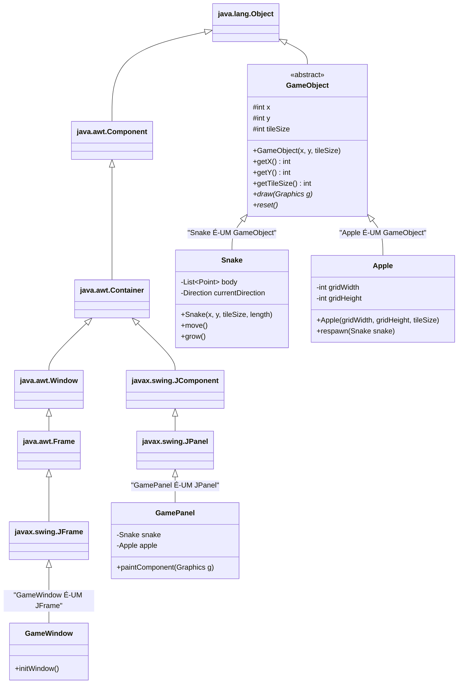

# Pilar da Herança Aplicado ao Snake Game

Este documento detalha como o pilar da **Herança** foi implementado e explorado no projeto acadêmico **Snake Game (Jogo da Cobrinha)** em Java, abordando tanto a herança na modelagem do domínio do jogo quanto a herança de classes da biblioteca gráfica padrão do Java (Swing/AWT).

---

## 1. Fundamentação Teórica da Herança

### O que é Herança em POO e Java?
A **Herança** é o mecanismo da Programação Orientada a Objetos que permite que uma nova classe (chamada de **subclasse**, classe filha ou classe derivada) **adquira atributos e comportamentos de uma classe existente** (chamada de **superclasse**, classe mãe ou classe base).

Em Java:
- A relação estabelecida pela herança é semanticamente uma relação do tipo **"É-UM"** (*is-a*). Por exemplo: uma maçã *é um* objeto de jogo; uma janela de jogo *é um* frame de interface.
- Utiliza-se a palavra-chave reservada **`extends`** para declarar a extensão de uma classe:  
  `public class Snake extends GameObject { ... }`
- A linguagem Java adota o modelo de **herança simples para classes** (cada classe pode estender apenas uma superclasse direta), evitando as ambiguidades clássicas da herança múltipla (como o "problema do diamante"). Toda classe em Java, direta ou indiretamente, descende da classe raiz universal `java.lang.Object`.
- A palavra-chave **`super`** é empregada para invocar construtores (`super(...)`) ou métodos da superclasse imediata.

### Benefícios da Herança:
1. **Reutilização de Código:** Evita a repetição de campos e métodos idênticos em múltiplas classes.
2. **Especialização:** A classe derivada herda a estrutura comum e adiciona apenas as peculiaridades de que necessita.
3. **Polimorfismo e Extensibilidade:** Estabelece a base da hierarquia de tipos, permitindo que instâncias das subclasses sejam manipuladas pelo tipo da superclasse.

---

## 2. A Herança no Contexto do Snake Game

O projeto do Snake Game explora a herança em duas frentes fundamentais:
1. **Hierarquia de Domínio (Entidades do Jogo):**
   - Superclasse: [`GameObject`](file:///c:/Users/joaov/Desktop/Backend-2S-ADS/snake-game/src/GameObject.java)
   - Subclasses concretas: [`Snake`](file:///c:/Users/joaov/Desktop/Backend-2S-ADS/snake-game/src/Snake.java) e [`Apple`](file:///c:/Users/joaov/Desktop/Backend-2S-ADS/snake-game/src/Apple.java)
2. **Hierarquia de Interface Gráfica (Java Swing):**
   - [`GamePanel`](file:///c:/Users/joaov/Desktop/Backend-2S-ADS/snake-game/src/GamePanel.java) estende `javax.swing.JPanel`.
   - [`GameWindow`](file:///c:/Users/joaov/Desktop/Backend-2S-ADS/snake-game/src/GameWindow.java) estende `javax.swing.JFrame`.



---

## 3. Análise Detalhada dos Trechos de Código em `src/`

### 3.1. A Superclasse: `GameObject.java`

A superclasse define o estado e as operações compartilhadas por qualquer elemento gráfico do grid:

```java
// Localização: src/GameObject.java (linhas 13-30)
public abstract class GameObject {
    // Atributos protegidos compartilhados com as subclasses
    protected int x;
    protected int y;
    protected int tileSize;

    public GameObject(int x, int y, int tileSize) {
        this.x = x;
        this.y = y;
        this.tileSize = tileSize;
    }

    public int getX() { return x; }
    public void setX(int x) { this.x = x; }

    public int getY() { return y; }
    public void setY(int y) { this.y = y; }

    public int getTileSize() { return tileSize; }
    public void setTileSize(int tileSize) { this.tileSize = tileSize; }

    public abstract void draw(Graphics g);
    public abstract void reset();
}
```

---

### 3.2. A Subclasse Especializada: `Apple.java`

A classe [`Apple.java`](file:///c:/Users/joaov/Desktop/Backend-2S-ADS/snake-game/src/Apple.java) herda os membros de `GameObject` e chama seu construtor via `super(...)`:

```java
// Localização: src/Apple.java (linhas 16-35)
public class Apple extends GameObject { // Aplicação de Herança com "extends"
    private static final Random RANDOM = new Random();
    private final int gridWidth;
    private final int gridHeight;

    public Apple(int gridWidth, int gridHeight, int tileSize) {
        // Invocação do construtor da superclasse GameObject
        super(0, 0, tileSize);
        
        // Inicialização de atributos específicos da maçã
        this.gridWidth = gridWidth;
        this.gridHeight = gridHeight;
        reset();
    }
}
```
**O que acontece aqui:**
- `Apple` não precisa declarar novamente as variáveis `x`, `y` ou `tileSize`.
- `Apple` já possui os métodos `getX()`, `getY()`, `getTileSize()` por herança direta.
- `Apple` adiciona seus próprios atributos especializados: `gridWidth`, `gridHeight` e o gerador aleatório `RANDOM`.

---

### 3.3. A Subclasse Especializada: `Snake.java`

A classe [`Snake.java`](file:///c:/Users/joaov/Desktop/Backend-2S-ADS/snake-game/src/Snake.java) também herda de `GameObject`:

```java
// Localização: src/Snake.java (linhas 20-45)
public class Snake extends GameObject {
    private final List<Point> body;
    private Direction currentDirection;
    private Direction nextDirection;
    private boolean growing;
    private final int initialX;
    private final int initialY;
    private final int initialLength;

    public Snake(int startX, int startY, int tileSize, int initialLength) {
        // Transfere as coordenadas iniciais da cabeça e o tamanho do bloco para a superclasse
        super(startX, startY, tileSize);
        
        this.initialX = startX;
        this.initialY = startY;
        this.initialLength = initialLength;
        this.body = new ArrayList<>();
        reset();
    }
}
```
Durante o método de movimentação `move()`, a cobra atualiza diretamente as variáveis `x` e `y` herdadas de `GameObject`:
```java
// Localização: src/Snake.java (linhas 95-97)
// Atualiza as coordenadas x e y herdadas da classe GameObject
this.x = newHeadX;
this.y = newHeadY;
```

---

### 3.4. Herança de Biblioteca Gráfica: `GamePanel.java` e `GameWindow.java`

A herança em Java não se limita às classes criadas pelo próprio desenvolvedor; ela é o alicerce para integração com a plataforma Java Swing:

#### `GamePanel.java` estende `JPanel`:
```java
// Localização: src/GamePanel.java (linhas 30-38 e 168-170)
public class GamePanel extends JPanel implements ActionListener {
    // Herda capacidades de container Swing e métodos gráficos como:
    // setPreferredSize, setBackground, addKeyListener, repaint...

    @Override
    protected void paintComponent(Graphics g) {
        // Chama a rotina nativa de limpeza e pintura de fundo do JPanel
        super.paintComponent(g);
        // ... renderização do jogo ...
    }
}
```

#### `GameWindow.java` estende `JFrame`:
```java
// Localização: src/GameWindow.java (linhas 10-25)
public class GameWindow extends JFrame {

    public GameWindow() {
        super("Snake Game - Jogo da Cobrinha (POO em Java)"); // Define o título na barra da janela
        initWindow();
    }

    private void initWindow() {
        GamePanel gamePanel = new GamePanel();
        add(gamePanel); // Herda o método add() de Container

        setDefaultCloseOperation(JFrame.EXIT_ON_CLOSE); // Herda gerenciamento de fechamento
        setResizable(false);                            // Herda dimensionamento
        pack();                                         // Herda auto-ajuste de layout
        setLocationRelativeTo(null);                    // Herda posicionamento na tela
    }
}
```

---

## 4. Comparação: Código COM Herança vs. Código SEM Herança

### Abordagem SEM Herança (Duplicação e Desperdício de Código)
Sem a herança de `GameObject`, cada classe precisaria reescrever exatamente os mesmos atributos e métodos de acesso:

```java
// ❌ MODELO SEM HERANÇA: Código duplicado em todas as classes
public class SnakeSemHeranca {
    private int x;
    private int y;
    private int tileSize;

    public int getX() { return x; }
    public void setX(int x) { this.x = x; }
    public int getY() { return y; }
    public void setY(int y) { this.y = y; }
    public int getTileSize() { return tileSize; }
    // ... repete tudo de novo ...
}

public class AppleSemHeranca {
    private int x; // Código repetido!
    private int y; // Código repetido!
    private int tileSize; // Código repetido!

    public int getX() { return x; } // Código repetido!
    public void setX(int x) { this.x = x; } // Código repetido!
    // ... repete tudo de novo ...
}
```
**Consequências:**
- Se o formato de coordenadas ou a escala `tileSize` mudar, é necessário alterar todas as classes individualmente.
- Não é possível criar uma coleção comum como `List<GameObject>` para renderizar o cenário, pois `SnakeSemHeranca` e `AppleSemHeranca` não possuem ancestral em comum.

### Abordagem COM Herança (Projeto Atual)
```java
// ✅ MODELO COM HERANÇA: Centralização em GameObject
public abstract class GameObject {
    protected int x, y, tileSize;
    // Getters e setters escritos uma única vez!
}

public class Snake extends GameObject { ... }
public class Apple extends GameObject { ... }
```
**Ganhos:**
- Redução drástica de linhas de código duplicadas.
- Facilidade de manutenção: qualquer alteração de coordenadas na classe base reflete automaticamente em todas as subclasses.

---

## 5. Relação da Herança com os Demais Pilares

1. **Herança e Polimorfismo:** A herança é o pré-requisito indispensável para o polimorfismo de inclusão. O `GamePanel` só consegue tratar `Snake` e `Apple` como `GameObject` porque ambas herdam de `GameObject`.
2. **Herança e Abstração:** A classe abstrata `GameObject` atua como superclasse, fornecendo esqueleto de código e forçando a implementação de métodos abstratos via herança.
3. **Herança e Encapsulamento:** O modificador `protected` em `GameObject` cria uma fronteira de acesso seletiva: permite que as subclasses acessem os atributos da mãe sem abri-los para o público geral (`public`).

---

## 6. Guia Rápido para Apresentação Acadêmica

> **Pergunta provável do professor:**  
> *"Qual é a importância da chamada `super(startX, startY, tileSize)` no construtor de `Snake` e de `Apple`?"*

**Resposta modelo:**  
Em Java, quando uma subclasse é instanciada, o construtor da sua superclasse **deve ser executado antes** do corpo do construtor da subclasse. Como a superclasse `GameObject` não possui um construtor padrão vazio (pois exige obrigatoriamente as coordenadas `x`, `y` e a escala `tileSize`), as classes filhas `Snake` e `Apple` são obrigadas a chamar explicitamente `super(...)` como a primeira instrução de seus construtores. Isso garante que o estado da classe mãe seja devidamente inicializado antes de qualquer operação da classe filha.

