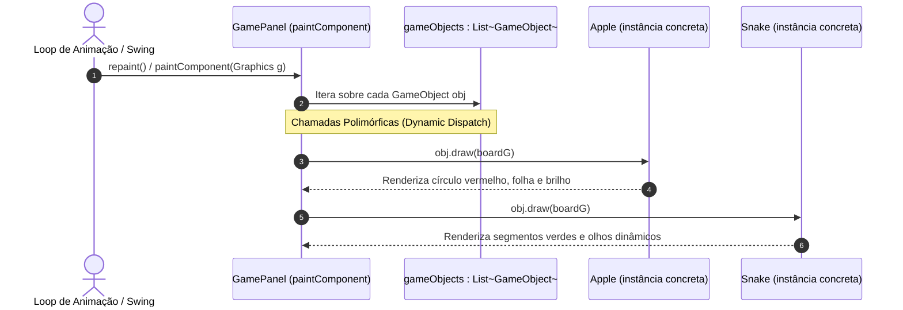

# Pilar do Polimorfismo Aplicado ao Snake Game

Este documento detalha como o pilar do **Polimorfismo** foi aplicado no projeto acadêmico **Snake Game (Jogo da Cobrinha)** em Java, demonstrando a elegância do despacho dinâmico de métodos (*dynamic dispatch*), o desacoplamento de código e a aderência a princípios modernos de arquitetura de software (como o Princípio Aberto/Fechado do SOLID).

---

## 1. Fundamentação Teórica do Polimorfismo

### O que é Polimorfismo em POO e Java?
A palavra **Polimorfismo** tem origem grega (*poly* = muitas, *morphos* = formas) e designa a capacidade de **tratar objetos de classes diferentes através de um tipo comum (superclasse ou interface), executando em tempo de execução o comportamento específico de cada classe concreta**.

Na linguagem Java, o polimorfismo manifesta-se principalmente de duas maneiras:
1. **Polimorfismo de Sobrecarga (*Overloading* - Estático ou em Tempo de Compilação):** Métodos com o mesmo nome na mesma classe, mas com listas de parâmetros ou tipos distintos.
2. **Polimorfismo de Inclusão ou Sobrescrita (*Overriding* - Dinâmico ou em Tempo de Execução):** Uma subclasse substitui ou especializa a implementação de um método declarado em sua superclasse utilizando a anotação **`@Override`**.

### Ligação Dinâmica (*Dynamic Binding / Late Binding*):
Quando invocamos um método sobrescrito através de uma referência da superclasse:
```java
GameObject obj = new Snake(...);
obj.draw(g);
```
O compilador Java verifica apenas se a classe `GameObject` possui a assinatura `draw(Graphics g)`. Em tempo de execução, a Máquina Virtual Java (JVM) inspeciona o objeto real em memória e descobre que se trata de uma instância de `Snake`, executando automaticamente o método `draw` especializado da cobra. Esse mecanismo é denominado **Despacho Dinâmico de Métodos (*Dynamic Method Dispatch*)**.

### Benefícios do Polimorfismo:
- **Desacoplamento:** Quem chama o método não precisa saber qual é a classe concreta do objeto.
- **Eliminação de Código Condicional Frágil:** Elimina verificações manuais de tipo com operadores `instanceof` e conversões explícitas de tipo (*casting*).
- **Extensibilidade (Princípio Aberto/Fechado):** Permite adicionar novas entidades ao jogo sem modificar os módulos existentes de renderização.

---

## 2. O Polimorfismo no Contexto do Snake Game

No Snake Game, tanto a cobra quanto a maçã precisam ser desenhadas no tabuleiro a cada quadro de animação e precisam ter seus estados redefinidos ao reiniciar a partida.

No entanto, suas rotinas visuais e de estado são completamente diferentes:
- `Apple`: Desenha sombra, corpo vermelho esférico, ponto de brilho e folha verde.
- `Snake`: Desenha cabeça verde esmeralda com olhos orientados pela direção atual e dezenas de segmentos articulados com cantos arredondados e gradiente de cor.

Graças ao polimorfismo, o painel [`GamePanel`](file:///c:/Users/joaov/Desktop/Backend-2S-ADS/snake-game/src/GamePanel.java) mantém uma lista genérica do tipo `List<GameObject>`. No método de pintura `paintComponent(Graphics g)`, o painel apenas itera sobre essa lista e chama `obj.draw(boardG)`. Cada elemento executa sua própria versão visual de forma transparente.



---

## 3. Análise Detalhada dos Trechos de Código em `src/`

### 3.1. A Coleção e a Chamada Polimórfica: `GamePanel.java`

No arquivo [`GamePanel.java`](file:///c:/Users/joaov/Desktop/Backend-2S-ADS/snake-game/src/GamePanel.java), o polimorfismo é aplicado tanto no armazenamento quanto no ciclo de desenho:

```java
// Localização: src/GamePanel.java (linhas 46-52 e 68-75)
/**
 * Polimorfismo na prática:
 * Lista genérica que armazena qualquer subclasse de GameObject (Snake, Apple).
 * O laço de renderização itera por esta lista chamando draw(), executando o
 * comportamento especializado de cada classe derivada.
 */
private final List<GameObject> gameObjects;

public GamePanel() {
    // ...
    this.snake = new Snake(GRID_WIDTH / 2, GRID_HEIGHT / 2, TILE_SIZE, 3);
    this.apple = new Apple(GRID_WIDTH, GRID_HEIGHT, TILE_SIZE);

    // Registra os objetos na lista polimórfica de GameObject
    this.gameObjects = new ArrayList<>();
    this.gameObjects.add(apple); // Desenha a maçã primeiro (abaixo da cobra)
    this.gameObjects.add(snake); // Desenha a cobra por cima da maçã
}
```

E no momento da renderização gráfica em `paintComponent`:

```java
// Localização: src/GamePanel.java (linhas 182-191)
/*
 * DEMONSTRAÇÃO DO POLIMORFISMO:
 * Iteramos sobre a lista de GameObjects. Cada objeto (Apple, Snake)
 * executa sua própria versão do método draw(Graphics g).
 * O GamePanel não precisa saber se o objeto é uma cobra ou maçã.
 */
for (GameObject obj : gameObjects) {
    obj.draw(boardG); // Chamada polimórfica em ação!
}
```

O `GamePanel` não tem ideia de que `gameObjects.get(0)` é uma maçã ou de que `gameObjects.get(1)` é uma cobra. Ele apenas invoca a operação `draw(boardG)`.

---

### 3.2. A Sobrescrita Especializada na Maçã: `Apple.java`

No arquivo [`Apple.java`](file:///c:/Users/joaov/Desktop/Backend-2S-ADS/snake-game/src/Apple.java), os métodos herdados são sobrescritos com `@Override`:

```java
// Localização: src/Apple.java (linhas 60-97)
@Override
public void reset() {
    this.x = RANDOM.nextInt(gridWidth);
    this.y = RANDOM.nextInt(gridHeight);
}

@Override
public void draw(Graphics g) {
    Graphics2D g2d = (Graphics2D) g;
    g2d.setRenderingHint(RenderingHints.KEY_ANTIALIASING, RenderingHints.VALUE_ANTIALIAS_ON);

    int px = x * tileSize;
    int py = y * tileSize;
    int padding = 3;
    int size = tileSize - (padding * 2);

    // Sombra suave sob a maçã
    g2d.setColor(new Color(0, 0, 0, 50));
    g2d.fillOval(px + padding + 1, py + padding + 2, size, size);

    // Corpo da maçã (vermelho)
    g2d.setColor(new Color(231, 76, 60));
    g2d.fillOval(px + padding, py + padding, size, size);

    // Ponto de brilho
    g2d.setColor(new Color(255, 255, 255, 140));
    g2d.fillOval(px + padding + (size / 4), py + padding + (size / 5), size / 4, size / 4);

    // Folha verde
    g2d.setColor(new Color(39, 174, 96));
    g2d.fillOval(px + (tileSize / 2) - 1, py + 1, 4, 6);
}
```

---

### 3.3. A Sobrescrita Especializada na Cobra: `Snake.java`

No arquivo [`Snake.java`](file:///c:/Users/joaov/Desktop/Backend-2S-ADS/snake-game/src/Snake.java), a mesma chamada `obj.draw(boardG)` desencadeia uma lógica completamente distinta:

```java
// Localização: src/Snake.java (linhas 186-215)
@Override
public void draw(Graphics g) {
    Graphics2D g2d = (Graphics2D) g;
    g2d.setRenderingHint(RenderingHints.KEY_ANTIALIASING, RenderingHints.VALUE_ANTIALIAS_ON);

    int padding = 1;
    int size = tileSize - (padding * 2);

    for (int i = 0; i < body.size(); i++) {
        Point segment = body.get(i);
        int px = segment.x * tileSize + padding;
        int py = segment.y * tileSize + padding;

        if (i == 0) {
            // Desenha a cabeça verde esmeralda com cantos arredondados
            g2d.setColor(new Color(46, 204, 113));
            g2d.fillRoundRect(px, py, size, size, 10, 10);
            drawEyes(g2d, px, py, size); // Desenha pupilas orientadas
        } else {
            // Desenha os segmentos do corpo
            int colorShift = Math.min(50, i * 2);
            Color bodyColor = new Color(39 + (colorShift / 3), 174 - (colorShift / 2), 96);
            g2d.setColor(bodyColor);
            g2d.fillRoundRect(px + 1, py + 1, size - 2, size - 2, 8, 8);
        }
    }
}
```

---

### 3.4. Polimorfismo por Interface: `ActionListener` em `GamePanel.java`

O polimorfismo no Snake Game também ocorre através da interface padrão do Java `java.awt.event.ActionListener`:

```java
// Localização: src/GamePanel.java (linhas 30, 81 e 118-124)
public class GamePanel extends JPanel implements ActionListener {
    // ...
    this.timer = new Timer(GAME_DELAY_MS, this); // Registra GamePanel como ouvinte polimórfico
    // ...

    @Override
    public void actionPerformed(ActionEvent e) {
        if (currentState == GameState.RUNNING) {
            updateGame();
        }
        repaint();
    }
}
```
O `javax.swing.Timer` não precisa saber o que é um `GamePanel`. Ele apenas conhece a interface `ActionListener` e chama polimorficamente `actionPerformed(e)` a cada 110 milissegundos.

---

## 4. Comparação: Código COM Polimorfismo vs. Código SEM Polimorfismo

A importância prática do polimorfismo fica evidente ao contrastar como o código seria escrito sem ele:

### Abordagem SEM Polimorfismo (Uso Indevido de `instanceof` e *Casting*)
Se o Java não tivesse despacho dinâmico polimórfico, o desenvolvedor seria obrigado a criar estruturas com checagem de tipos manuais:

```java
// ❌ MODELO SEM POLIMORFISMO: Verificações manuais e casting explícito
public void desenharSemPolimorfismo(List<Object> objetos, Graphics g) {
    for (Object obj : objetos) {
        if (obj instanceof Apple) {
            Apple apple = (Apple) obj; // Casting manual
            apple.desenharMacaVermelha(g);
        } else if (obj instanceof Snake) {
            Snake snake = (Snake) obj; // Casting manual
            snake.desenharCorpoCobrinha(g);
        } else if (obj instanceof GoldenApple) {
            GoldenApple golden = (GoldenApple) obj; // Mais um if para cada novidade!
            golden.desenharFrutaDourada(g);
        }
    }
}
```
**Problemas graves desta abordagem:**
- **Violação do Princípio Aberto/Fechado (OCP):** Cada novo elemento introduzido no jogo obriga a abrir o método de renderização para adicionar um novo bloco `else if` e mais um *casting*.
- **Risco de Erros em Tempo de Execução:** Se o desenvolvedor esquecer um `else if` ou fizer um *cast* para o tipo errado, o programa pode quebrar com `ClassCastException`.
- **Código verboso, repetitivo e difícil de testar.**

### Abordagem COM Polimorfismo (Projeto Atual)
```java
// ✅ MODELO COM POLIMORFISMO: Elegante, limpo e infinitamente extensível
for (GameObject obj : gameObjects) {
    obj.draw(boardG); // A JVM decide dinamicamente a execução!
}
```
**Vantagens:**
- **Extensibilidade Imediata:** Se amanhã criarmos a classe `GoldenApple extends GameObject` ou `Obstacle extends GameObject`, **não é necessário alterar uma única linha em `GamePanel.java`**. Basta instanciar a nova fruta e adicioná-la à lista `gameObjects.add(new GoldenApple(...))`. O polimorfismo cuidará do restante!

---

## 5. Relação do Polimorfismo com os Demais Pilares

1. **Polimorfismo e Herança:** O polimorfismo de inclusão só existe porque `Snake` e `Apple` herdam de `GameObject`. A herança cria a família de tipos compatíveis.
2. **Polimorfismo e Abstração:** A abstração define o contrato conceitual `public abstract void draw(Graphics g);` em `GameObject`. O polimorfismo garante que esse contrato seja invocado de forma transparente sobre qualquer instância derivada.
3. **Polimorfismo e Encapsulamento:** Ao chamar `obj.draw(boardG)`, o chamador não invade o estado interno dos objetos. Cada objeto encapsula suas próprias cores, coordenadas de nós e lógicas de desenho.

---

## 6. Guia Rápido para Apresentação Acadêmica

> **Pergunta provável do professor:**  
> *"O que acontece por baixo dos panos na JVM quando a linha `obj.draw(boardG);` é executada dentro do for de `gameObjects`?"*

**Resposta modelo:**  
Em tempo de compilação, o compilador verifica que a classe `GameObject` possui o método `draw(Graphics g)`. Em tempo de execução, a JVM analisa a referência do objeto real armazenado na memória *heap*. Se o objeto for uma instância de `Apple`, a JVM consulta a tabela de métodos virtuais (*vtable*) de `Apple` e despacha a execução para `Apple.draw()`. Se for uma instância de `Snake`, a JVM despacha a execução para `Snake.draw()`. Esse processo é o **despacho dinâmico de métodos (*dynamic dispatch*)**, que constitui o cerne do polimorfismo em Java.

