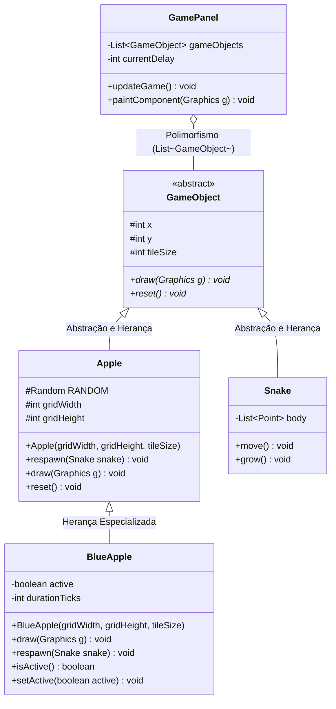

 # Plano de Implementação: Maçã Azul (Desaceleradora)

Este documento detalha o planejamento técnico, pedagógico e arquitetural para a introdução da **Maçã Azul** no **Snake Game**. O foco central deste documento é demonstrar como o novo recurso é desenvolvido em perfeita consonância com os **4 Pilares da Programação Orientada a Objetos (POO)** consolidados na pasta [`docs/`](file:///c:/Users/joaov/Desktop/Backend-2S-ADS/snake-game/docs).

---

## 1. Visão Geral da Funcionalidade

### 1.1. Motivação e Mecânica de Jogo (Gameplay)
No jogo atual, cada maçã vermelha consumida faz a cobra crescer e **acelera** o jogo (reduz o `currentDelay` do `Timer` em -3ms, tornando a cobra cada vez mais veloz e o jogo mais desafiador). 

A **Maçã Azul** surge como um item especial e estratégico:
- **Efeito Principal (Desaceleração):** Ao ser ingerida, a maçã azul **reduz a velocidade** da cobra (ou seja, **aumenta** o `currentDelay` do `Timer`, por exemplo em +10ms, até o limite de conforto de 110ms), dando ao jogador uma folga de reflexo em momentos críticos de velocidade alta.
- **Pontuação Bônus:** Concede uma pontuação diferenciada (ex: +20 pontos).
- **Crescimento:** Pode não fazer a cobra crescer (ou crescer normalmente), funcionando como um "power-down de velocidade / power-up de controle".
- **Visual Distinto:** Fruta estilizada em tons de azul safira/ciano com aura ou brilho próprio para rápido reconhecimento visual pelo jogador.

---

## 2. Aplicação Direta dos Conceitos Abordados em `docs/`

O desenvolvimento da maçã azul foi desenhado para ser o **exemplo prático definitivo de extensibilidade de software** orientado a objetos, conectando-se diretamente a cada documento de [`docs/`](file:///c:/Users/joaov/Desktop/Backend-2S-ADS/snake-game/docs):



---

### 2.1. Conexão com [Abstracao_aplicada.md](file:///c:/Users/joaov/Desktop/Backend-2S-ADS/snake-game/docs/Abstracao_aplicada.md)

Como demonstrado em `docs/Abstracao_aplicada.md`, a classe abstrata base [`GameObject`](file:///c:/Users/joaov/Desktop/Backend-2S-ADS/snake-game/src/GameObject.java) estabelece as características essenciais de qualquer entidade do grid:
- Posicionamento cartesiano (`x`, `y`) e escala (`tileSize`).
- O contrato obrigatório de renderização: `public abstract void draw(Graphics g)`.
- O contrato de reinício: `public abstract void reset()`.

#### Como a Maçã Azul aplica a Abstração:
A `BlueApple` respeita rigorosamente essa abstração. O motor gráfico do jogo não precisa saber detalhes internos da maçã azul (como os gradientes azuis ou cálculos trigonométricos de brilho ciano); ele apenas sabe que a maçã azul é uma entidade com coordenadas e que atende à operação essencial `draw`.

---

### 2.2. Conexão com [Heranca_aplicada.md](file:///c:/Users/joaov/Desktop/Backend-2S-ADS/snake-game/docs/Heranca_aplicada.md)

Em `docs/Heranca_aplicada.md`, exploramos a relação **"É-UM"** (*is-a*) e a reutilização de código com a palavra-chave `extends` e o construtor `super(...)`.

Para a Maçã Azul, a arquitetura adota uma **hierarquia em dois níveis**, que enriquece ainda mais o projeto acadêmico:
$$\text{GameObject (Superclasse Base)} \longrightarrow \text{Apple (Subclasse)} \longrightarrow \text{BlueApple (Subclasse Especializada)}$$

#### Benefícios de herdar de `Apple` (`public class BlueApple extends Apple`):
1. **Reúso imediato de algoritmos complexos:** A `BlueApple` herda integralmente o método `respawn(Snake snake)` de `Apple`, que garante matematicamente que ela jamais surgirá sobre o corpo da cobra.
2. **Reúso de estado:** Herda `gridWidth`, `gridHeight`, `x`, `y` e `tileSize`, invocando `super(gridWidth, gridHeight, tileSize)` no construtor.
3. **Especialização de comportamento:** Adiciona apenas o que é exclusivo da fruta azul: sua renderização gráfica personalizada e seus atributos de controle temporal.

---

### 2.3. Conexão com [Polimorfirsmo_aplicado.md](file:///c:/Users/joaov/Desktop/Backend-2S-ADS/snake-game/docs/Polimorfirsmo_aplicado.md)

Este é o ponto mais alto da arquitetura POO no projeto. Em `docs/Polimorfirsmo_aplicado.md`, explicamos o **Princípio Aberto/Fechado (OCP)**: o código deve estar aberto para extensão, mas fechado para modificação.

#### Como o Polimorfismo atua na Maçã Azul:
No [`GamePanel.java`](file:///c:/Users/joaov/Desktop/Backend-2S-ADS/snake-game/src/GamePanel.java), a coleção de renderização é genérica:
```java
private final List<GameObject> gameObjects;
```
Ao inicializar o jogo:
```java
this.gameObjects.add(blueApple); // Adicionada à lista polimórfica
```
No laço de desenho do método `paintComponent`:
```java
for (GameObject obj : gameObjects) {
    obj.draw(boardG); // CHAMADA POLIMÓRFICA PURA!
}
```
**O `GamePanel` não precisa de nenhum `if (obj instanceof BlueApple)` para desenhar a nova fruta!** A JVM utiliza o **despacho dinâmico (*dynamic dispatch*)** para identificar em tempo de execução que a referência aponta para um objeto `BlueApple` e invoca automaticamente a versão azul do método `draw`.

---

### 2.4. Conexão com [Encapsulamento_aplicado.md](file:///c:/Users/joaov/Desktop/Backend-2S-ADS/snake-game/docs/Encapsulamento_aplicado.md)

Como detalhado em `docs/Encapsulamento_aplicado.md`, o encapsulamento protege os dados internos contra corrupção externa e garante a integridade das regras do jogo.

#### Como a Maçã Azul aplica o Encapsulamento:
1. **Proteção de Visibilidade e Ativação:**
   - Atributos como `active` (indicando se a maçã azul está atualmente no tabuleiro ou aguardando o momento de reaparecer) são `private`.
   - O acesso é mediado por `isActive()` e `setActive(boolean active)`.
2. **Encapsulamento do Timer no `GamePanel`:**
   - A alteração da velocidade (`currentDelay`) é mantida estritamente dentro de `GamePanel.java`, protegida por limites bem definidos:
     $$\text{currentDelay} = \min(\text{INITIAL\_DELAY\_MS}, \text{currentDelay} + \text{SLOW\_STEP})$$
   - Isso impede que a cobra desacelere a ponto de parar ou bugar o relógio do Swing.

---

## 3. Especificação Técnica do Código Proposto

### 3.1. Nova Classe: `src/BlueApple.java`

```java
import java.awt.Color;
import java.awt.Graphics;
import java.awt.Graphics2D;
import java.awt.RenderingHints;

/**
 * Representa a Maçã Azul (item especial desacelerador).
 *
 * Pilares da POO aplicados:
 * - Herança: estende Apple (BlueApple É-UMA Apple que É-UM GameObject).
 * - Polimorfismo: sobrescreve o método draw(Graphics g) com a arte visual azul safira.
 * - Encapsulamento: controla seu próprio estado de ativação e visibilidade no tabuleiro.
 */
public class BlueApple extends Apple {
    private boolean active; // Indica se a fruta está disponível no tabuleiro

    public BlueApple(int gridWidth, int gridHeight, int tileSize) {
        super(gridWidth, gridHeight, tileSize);
        this.active = false; // Começa desativada, surgindo periodicamente
    }

    public boolean isActive() {
        return active;
    }

    public void setActive(boolean active) {
        this.active = active;
    }

    /**
     * Polimorfismo: implementação visual exclusiva da fruta azul.
     */
    @Override
    public void draw(Graphics g) {
        if (!active) {
            return; // Se não estiver ativa, não renderiza
        }

        Graphics2D g2d = (Graphics2D) g;
        g2d.setRenderingHint(RenderingHints.KEY_ANTIALIASING, RenderingHints.VALUE_ANTIALIAS_ON);

        int px = x * tileSize;
        int py = y * tileSize;
        int padding = 3;
        int size = tileSize - (padding * 2);

        // 1. Aura / Brilho suave externo azul ciano
        g2d.setColor(new Color(52, 152, 219, 70));
        g2d.fillOval(px + padding - 2, py + padding - 2, size + 4, size + 4);

        // 2. Sombra inferior
        g2d.setColor(new Color(0, 0, 0, 50));
        g2d.fillOval(px + padding + 1, py + padding + 2, size, size);

        // 3. Corpo da fruta (Azul Safira Vibrante)
        g2d.setColor(new Color(41, 128, 185));
        g2d.fillOval(px + padding, py + padding, size, size);

        // 4. Ponto de luz e brilho 2D superior
        g2d.setColor(new Color(255, 255, 255, 170));
        g2d.fillOval(px + padding + (size / 4), py + padding + (size / 5), size / 4, size / 4);

        // 5. Folha em ciano metálico
        g2d.setColor(new Color(26, 188, 156));
        g2d.fillOval(px + (tileSize / 2) - 1, py + 1, 4, 6);
    }
}
```

---

### 3.2. Integração no `src/GamePanel.java`

#### Constantes e Atributos:
```java
// Parâmetros da Maçã Azul
public static final int SLOW_STEP = 10;         // Alivia +10ms no Timer (desacelera)
public static final int BLUE_APPLE_SCORE = 20;  // Pontos concedidos
private final BlueApple blueApple;
private int applesEatenCount;                   // Contador para controlar o surgimento
```

#### No Construtor `GamePanel()`:
```java
this.blueApple = new BlueApple(GRID_WIDTH, GRID_HEIGHT, TILE_SIZE);
// Registra na lista polimórfica (o loop de desenho não precisa mudar nada!)
this.gameObjects.add(blueApple);
```

#### Na Lógica de Atualização `updateGame()`:
```java
// Coleta da Maçã Azul (Desaceleração)
if (blueApple.isActive() && head.x == blueApple.getX() && head.y == blueApple.getY()) {
    score += BLUE_APPLE_SCORE;
    if (score > highScore) {
        highScore = score;
    }
    
    // DESACELERAÇÃO: Aumenta o delay até o limite do ritmo inicial (110ms)
    currentDelay = Math.min(INITIAL_DELAY_MS, currentDelay + SLOW_STEP);
    timer.setDelay(currentDelay);

    blueApple.setActive(false); // Some temporariamente até o próximo ciclo
}
```

#### Lógica de Surgimento Estratégico (Spawn):
A cada 4 ou 5 maçãs vermelhas consumidas, a maçã azul surge no mapa:
```java
// Dentro da coleta da maçã vermelha:
applesEatenCount++;
if (applesEatenCount % 4 == 0 && !blueApple.isActive()) {
    blueApple.respawn(snake);
    blueApple.setActive(true);
}
```

---

## 4. Comparação: Abordagem Procedural vs. Abordagem com os 4 Pilares

| Aspecto | Abordagem Sem POO (Procedural) | Abordagem com os 4 Pilares (Proposta) |
|---|---|---|
| **Adição da Nova Fruta** | Criação de dezenas de variáveis globais soltas (`blueX`, `blueY`, `isBlueActive`). | Classe dedicada `BlueApple` encapsulando seus dados e comportamentos. |
| **Hierarquia de Código** | Código de cálculo de posição e desenho duplicado da fruta vermelha. | Reúso via `extends Apple`, herdando algoritmo anti-sobreposição de graça. |
| **Renderização Gráfica** | Inserção de mais `if/else` e condicionais dentro de `paintComponent`. | Nenhuma alteração no laço gráfico: `obj.draw(boardG)` funciona polimorficamente. |
| **Proteção de Integridade** | Qualquer função pode alterar a velocidade para valores negativos e quebrar o jogo. | Métodos protegidos validam o limite máximo e mínimo de delay no `GamePanel`. |

---

## 5. Roteiro Passo a Passo de Execução

1. **Passo 1:** Criar a classe [`src/BlueApple.java`](file:///c:/Users/joaov/Desktop/Backend-2S-ADS/snake-game/src/BlueApple.java) herdando de `Apple`.
2. **Passo 2:** Atualizar [`src/GamePanel.java`](file:///c:/Users/joaov/Desktop/Backend-2S-ADS/snake-game/src/GamePanel.java) para instanciar a `BlueApple`, adicioná-la à lista polimórfica `gameObjects` e aplicar a desaceleração na colisão.
3. **Passo 3:** Adicionar novos testes automatizados em [`test/GameTest.java`](file:///c:/Users/joaov/Desktop/Backend-2S-ADS/snake-game/test/GameTest.java) para validar a criação, respawn e contrato polimórfico de `BlueApple`.
4. **Passo 4:** Compilar e validar a execução com zero erros via `javac`.
5. **Passo 5:** Atualizar os documentos de documentação em [`docs/`](file:///c:/Users/joaov/Desktop/Backend-2S-ADS/snake-game/docs) demonstrando a nova subclasse.

